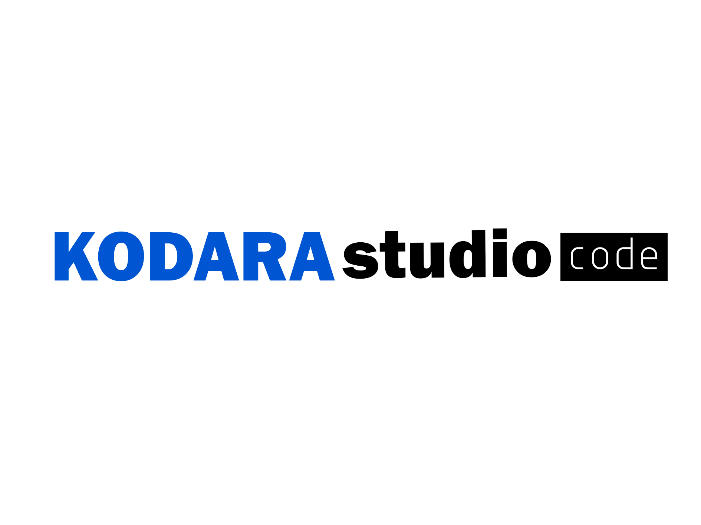

# KODARA-Studio-Code
Kodara Studio Code is a code editor designed for programming, with a focus on Python, though it also supports other languages.

## Build a setup installer locally

See [installer-builder](./installer-builder/README_RU.txt). Copy your built `KODARAStudioCode.exe` to `installer-builder/payload/KODARAStudioCode.exe`, then run `installer-builder/Build-Installer.bat` on Windows. The generated setup will be written to `installer-builder/dist/KODARAStudioCode_Setup.exe`. Inno Setup 6 is required; the builder can offer to install it through winget.
